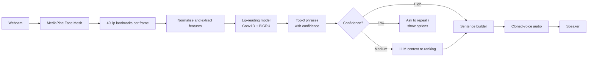

# SilentSpeech

> **AI that gives a voice back to people who have lost theirs.**

SilentSpeech is a real-time, software-only assistive system. It reads silent lip movements through an ordinary laptop webcam, recognises the phrase being mouthed, and speaks it aloud in the user's own cloned voice.

| | |
|---|---|
| **Competition** | `[Competition name]` |
| **Team** | OriginX — B.Tech 2nd year, `[College name]` |
| **Category** | AI for social good · Assistive technology · Healthcare |
| **Hardware cost** | ₹0 (any laptop with a webcam) |
| **Status** | Working prototype |

---

## Quick start (about 10 minutes)

**Windows:** double-click `start.bat`. **macOS / Linux:** `sh start.sh`. (Or run `python start.py` in an activated environment.)

The first run installs everything (about 1 GB). Then a guided setup:

1. **Check:** camera, face tracking, lighting and speakers.
2. **Calibrate:** silently mouth 10 demo phrases, 4 times each. The recorder moves on by itself (about 4 minutes).
3. **Self-test and deep training:** it reports how well your clips were recognised and offers extra clips for weak phrases. Then neural networks learn your own lip movements (about 3–4 minutes on a slow laptop).
4. **Voice:** say each phrase once to use your own voice, or use the computer voice.
5. **Live app:** press SPACE, mouth a phrase, and hear it.

Two recognisers learn from your calibration clips. The *instant templates* work straight away: they compare what you mouth with your clips (section 6.7). The *deep model*, an ensemble of neural networks trained on the same clips, takes over once it measurably beats them: 76% against 66% on the first real calibration (section 6.8). For the competition dataset and the big neural model, follow sections 13–15. Run `start.py` again any time; finished steps are skipped.

| Double-click | What it does |
|---|---|
| `start.bat` | First-time setup and calibration (above) |
| `app.bat` | Open the live app straight away |
| `train_more.bat` | Record 4 more examples of every phrase (about 4 minutes), retrain, then show accuracy before and after. **The most effective way to make it more accurate.** |
| `train_deep.bat` | Retrain the deep model on all your clips (about 3–4 minutes) and show an honest accuracy check against the templates |
| `add_phrase.bat` | Add **your own phrase**, any words in any language ("Turn on the news", "राम लाई बोलाउनुहोस्"), and teach it in about a minute |

**Getting more accuracy:** more examples per phrase help the most. On the first real calibration, accuracy rose from 47% with 1 example per phrase to 60% with 2 and 67% with 3. The app also learns while you use it: whenever you pick, correct or confirm a phrase with 1/2/3, that clip becomes a new example, and the deep model is retrained with those examples when you close the app. Finally, **F** in the live app switches to your most reliable phrases. With fewer, more distinct phrases accuracy is much higher: on that first calibration, 6 phrases scored about 96% against 75% for all 10.

---

## Table of contents

1. [Problem statement](#1-problem-statement)
2. [Our solution](#2-our-solution)
3. [Key features](#3-key-features)
4. [Live demo scenario](#4-live-demo-scenario)
5. [System architecture](#5-system-architecture)
6. [How it works (pipeline in detail)](#6-how-it-works-pipeline-in-detail)
7. [Tech stack](#7-tech-stack)
8. [Project structure](#8-project-structure)
9. [Requirements](#9-requirements)
10. [Installation](#10-installation)
11. [Configuration](#11-configuration)
12. [Phrase vocabulary design](#12-phrase-vocabulary-design)
13. [Data collection protocol](#13-data-collection-protocol)
14. [Model training](#14-model-training)
15. [Evaluation and results](#15-evaluation-and-results)
16. [Running the live demo app](#16-running-the-live-demo-app)
17. [LLM correction layer](#17-llm-correction-layer)
18. [Voice banking and voice cloning](#18-voice-banking-and-voice-cloning)
19. [New-user enrolment (personalisation)](#19-new-user-enrolment-personalisation)
20. [Responsible AI, privacy and ethics](#20-responsible-ai-privacy-and-ethics)
21. [Limitations](#21-limitations)
22. [Troubleshooting](#22-troubleshooting)
23. [Team roles](#23-team-roles)
24. [Project timeline](#24-project-timeline)
25. [Competition kit: PPT, poster, demo script, judge Q&A](#25-competition-kit-ppt-poster-demo-script-judge-qa)
26. [Future roadmap](#26-future-roadmap)
27. [Glossary](#27-glossary)
28. [References](#28-references)
29. [License and acknowledgements](#29-license-and-acknowledgements)

---

## 1. Problem statement

Speech is the most natural way humans communicate, yet many people lose it suddenly:

- **People who undergo a laryngectomy** (removal of the voice box), most often because of throat cancer. Oral and throat cancers are among the most common cancers in India.
- **ICU patients on ventilators or with a tracheostomy tube**, who are fully conscious but physically cannot produce sound.
- **Stroke survivors and people with vocal cord paralysis** or neurological conditions that weaken or remove the voice.

Most of these people **can still move their lips**. Today they communicate by writing on paper, pointing at alphabet boards, or gesturing. This is slow and tiring, and impossible when the hands are weak or paralysed. Families and nurses are left guessing, which leads to frustration, missed pain signals, and a loss of dignity.

Existing alternatives each have a gap. An electrolarynx sounds robotic and needs a device held to the throat. Speech valves only suit certain surgeries. Typing apps need working hands and are slow.

**Our core question:** Can an ordinary webcam and AI let a person "speak" just by silently moving their lips, in their own voice?

---

## 2. Our solution

SilentSpeech watches the user's lips through a webcam and tracks 40 points around the mouth in every frame. A deep learning model reads how those points move over time and recognises which phrase the user is mouthing. When the model is unsure, an LLM layer uses the recent conversation to pick the most sensible of its top guesses, and a sentence builder joins phrases into one message. Finally, the message is spoken aloud in a clone of the user's own voice, recorded in advance (a practice called **voice banking**).

Everything runs on a normal laptop CPU. No special sensors, no GPU, no cost.

---

## 3. Key features

| Feature | What it does |
|---|---|
| **Real-time silent lip reading** | Recognises 30–50 essential phrases from silent mouthing through a webcam. |
| **Facial muscle analysis** | 478-point face mesh plus 52 learned muscle-movement scores per frame, shown live as a face-mesh view. |
| **Own-voice output** | Speaks in the user's real recorded voice, or a clone of it, instead of a robotic voice. |
| **Context-aware correction** | An LLM re-ranks the model's top guesses using the recent conversation. |
| **Sentence builder** | Combines phrases ("I need water" + "Call my mother") into one message. |
| **Safe when unsure** | If confidence is low, it shows its top 3 guesses instead of speaking the wrong thing. |
| **Emergency alert** | Critical phrases such as "I can't breathe" trigger an on-screen and sound alert for caregivers. |
| **Quick personalisation** | A new user can enrol in about 10 minutes. |
| **Works without training** | After 4 clips per phrase, an instant recogniser is ready in seconds on any laptop. |
| **Your own phrases** | Add any phrase in any language (`add_phrase.bat`); it is recognised, spoken and shown on the board like the built-in ones. |
| **Tap to speak** | Click any phrase tile (or one of the 1/2/3 options) when lip reading isn't possible. |
| **Learns while you use it** | Every phrase picked, corrected or confirmed with 1/2/3 becomes a new example. |
| **Conversation record** | Everything said is written with the time to `logs/conversation-<date>.txt` for caregivers (can be turned off). |
| **Alerts that don't get lost** | An emergency alert repeats every 20 seconds until someone acknowledges it. |
| **Privacy by design** | Stores only lip coordinates, never raw video. Can run fully offline. |
| **Multilingual-ready** | The phrase set can be recorded in any language, including Indian languages. |

---

## 4. Live demo scenario

1. The presenter faces the laptop webcam and silently mouths **"I need water."**
2. The screen shows the lip landmarks being tracked live, then the predicted phrase with its confidence score.
3. Within about a second, the laptop says "I need water" **in the presenter's own cloned voice**.
4. The presenter mouths **"Call my mother."** The laptop says it, the sentence builder joins both phrases, and pressing ENTER speaks the whole message: *"I need water. Call my mother."*
5. The presenter mouths something deliberately unclear. Instead of guessing, the system shows its top 3 options on screen, demonstrating the safety feature.

---

## 5. System architecture



| Module | File | Responsibility |
|---|---|---|
| Landmark extractor | `src/landmarks.py` | Runs MediaPipe, returns the 40 lip points and 2 eye corners per frame |
| Feature builder | `src/features.py` | Normalises landmarks, adds velocities, resamples to a fixed length, checks clip quality |
| Dataset | `src/dataset.py` | Loads clips, applies augmentation, creates train/val/test splits |
| Augmentation | `src/augment.py` | Realistic variations of each clip for training |
| Model | `src/model.py` | Conv1D + BiGRU + attention lip-reading network |
| Instant templates | `src/templates.py` | Training-free recogniser: DTW nearest neighbours with calibrated confidence |
| Recogniser choice | `src/recognizer.py` | Picks the neural model or the speaker's templates |
| Decision logic | `src/decision.py` | Applies confidence thresholds and emergency rules |
| Metrics | `src/metrics.py` | Accuracy, F1, emergency recall, confusion matrix |
| LLM corrector | `src/llm_corrector.py` | Re-ranks uncertain predictions using conversation context |
| Speaker | `src/speaker.py` | Plays cloned-voice clips, or falls back to offline text-to-speech |

---

## 6. How it works (pipeline in detail)

### 6.1 Face and lip tracking

SilentSpeech uses **MediaPipe Face Landmarker**. One neural network finds **478 3D facial landmarks** per frame, and a second outputs **52 blendshapes**: scores from 0 to 1 for facial muscle movements such as `jawOpen`, `mouthPucker`, `mouthFunnel`, `mouthPress`, `mouthRollLower` and `mouthSmile`. The 28 mouth and jaw scores describe *what the mouth is doing* rather than where points are. On a low-power laptop CPU it takes about 40 ms per frame; if the model can't be downloaded, the older MediaPipe Face Mesh (468 points, no blendshapes) is used instead (`TRACKER` in `config.py`).

For lip reading we keep 20 outer-lip points, 20 inner-lip points, and 2 eye corners used for normalisation, plus the mouth and jaw blendshapes, which are saved next to each clip (`<session>_<rep>.bs.npy`). The full mesh drives the face-mesh view in the app.

```python
LIPS_OUTER  = [61, 146, 91, 181, 84, 17, 314, 405, 321, 375,
               291, 409, 270, 269, 267, 0, 37, 39, 40, 185]
LIPS_INNER  = [78, 95, 88, 178, 87, 14, 317, 402, 318, 324,
               308, 415, 310, 311, 312, 13, 82, 81, 80, 191]
EYE_CORNERS = [33, 263]
```

### 6.2 Normalisation

Raw coordinates change whenever the user moves closer, shifts sideways, or tilts their head. Normalisation removes these effects so the model sees only the **shape of the mouth**:

1. **Translate:** subtract the centre point of the lips, so position on screen doesn't matter.
2. **Scale:** divide by the distance between the two eye corners, so distance from the camera doesn't matter.
3. **Rotate:** rotate all points so the line between the eyes is horizontal, so head tilt doesn't matter.

### 6.3 Feature extraction

For every frame we compute:

- **Position features:** 40 points × (x, y) = 80 values
- **Velocity features:** the change in each value since the previous frame = 80 values

That gives **160 features per frame**. Because people mouth at different speeds, every clip is resampled to exactly **64 frames** using linear interpolation. The final model input for one clip is a tensor of shape **(64, 160)**.

**Why landmarks instead of raw video?**

| | Raw video frames | Lip landmarks (our approach) |
|---|---|---|
| Training data needed | Hundreds of hours | About 60–100 clips per phrase |
| Training time | Hours on a GPU | Minutes on a laptop CPU |
| Privacy | Stores the user's face | Stores only coordinates |
| Background and clothing | Can confuse the model | Ignored completely |
| Model size | Tens of millions of parameters | About 0.7 million parameters |

### 6.4 The lip-reading model

```
Input: (64 frames × 160 features)
 → Conv1D (160→128, kernel 5) + BatchNorm + ReLU + Dropout 0.3
 → Conv1D (128→128, kernel 5) + BatchNorm + ReLU
 → Bidirectional GRU (hidden 128, 2 layers, dropout 0.3)
 → Attention pooling over time
 → Linear (256→128) + ReLU + Dropout 0.3
 → Linear (128→N phrases) → Softmax
```

Each part has a job. The **convolution layers** detect short mouth shapes, like lips pressing together for "m" or rounding for "oo". The **bidirectional GRU** learns the order of those shapes across the whole phrase. **Attention pooling** lets the model focus on the most informative frames and ignore still moments at the start and end.

### 6.5 Knowing when the user is "speaking"

The app supports two modes:

- **Push-to-talk (default for demos):** pressing SPACE captures a 2.5-second window. This is the most reliable option on stage.
- **Auto mode:** the app watches lip movement and the Mouth Aspect Ratio (lip opening divided by lip width). When the lips move above a threshold for several frames, capture starts (keeping a short pre-roll so the start of the phrase isn't lost); when the lips stay still for 0.5 seconds, capture stops.

### 6.6 Decision logic

| Top-1 confidence | Action |
|---|---|
| ≥ 0.70 | Accept the phrase and speak it |
| 0.40 – 0.70 | Send the top-3 candidates to the LLM for context-based re-ranking |
| < 0.40 | Say nothing; show "Please repeat" and the top-3 options on screen |
| Any emergency phrase ≥ 0.40 | Trigger a caregiver alert immediately, then confirm |

These thresholds are starting values and are tuned on the validation set (see [section 15](#15-evaluation-and-results)). For emergency phrases, missing a real emergency is worse than a false alarm, so the alert threshold is deliberately lower.

### 6.7 Instant templates (no training)

The neural model needs hundreds of clips and a long training run (hours on a low-power laptop). For a new user, or when there is no time to train, SilentSpeech uses **nearest-neighbour matching with dynamic time warping (DTW)**:

1. Each calibration clip is reduced to a *signature*: the clip is resampled to 32 frames, its average mouth shape is subtracted (so it describes how the shape *changes*), and the smoothed speed of every point is added. On the first real calibration this scored 75% leave-one-out, against 35% for an earlier version that measured change from the "resting" lips at the start and end. Real users are often still moving at both ends. Clips where the lips barely moved, or that look unlike every other example of their phrase, are left out automatically.
   How much lip *speed* counts next to lip *shape* is chosen per person at calibration (×2 or ×5). With clips from two lighting conditions, the stronger weight lifted accuracy from 59% to 66–69%: movement survives a change of light better than shape does.
2. A new clip is compared with every stored signature. DTW lines the two up in time, so speaking faster or slower doesn't matter.
3. The phrase whose examples are closest wins. Confidence comes from how clearly it beats the runner-up, relative to the distance, so a whole-session shift (new day, new light) doesn't destroy it.
4. **Facial muscle scores:** when clips have the 52 blendshapes, the mouth and jaw scores can be added to each frame. Calibration tries several weights (0, 0.5, 1, 2) on that person's own clips and keeps the most accurate, so they are used only if they help. Clips recorded before the Face Landmarker have no scores; once every phrase has 3 or more newer clips, the recogniser built from those (with scores) is compared with the one built from all clips (without), and the better one is kept.
5. **Calibration:** each calibration clip is recognised from all the others (leave-one-out). That gives an accuracy estimate and sets the confidence scale so that average confidence equals measured accuracy. A clip far from every phrase (talking, laughing, a phrase not in the list) gets low confidence and is never spoken directly.

The app uses the neural model when it has been trained or enrolled on that speaker, then the deep model below, and the templates otherwise (`--recognizer` overrides). `evaluate.py --recognizer templates` reports the templates as a training-free baseline next to the neural model, which is a useful comparison for the results slide.

### 6.8 Deep model (neural networks trained on your own clips)

The templates only *compare* clips. The deep model *learns* what tells one person's phrases apart: an ensemble of 5 small 1-D convolutional networks (`src/deep.py`, about 39,000 weights each) trained on that person's own clips. `start.py` trains it after calibration, `train_more.bat` after every round of new clips, and the live app retrains it when it closes after learning new examples from your 1/2/3 choices. `train_deep.bat` does it on demand. It takes about 3–4 minutes on a 2-core Celeron laptop.

How it learns from only 4–8 clips per phrase:

- **Input:** the same 32-frame signature as the templates (lip shape relative to the clip's average, plus lip speed), standardised.
- **Augmentation:** every clip is seen as 64 pre-made variations: mirrored, tilted ±8°, scaled ±10%, 0.8–1.2× speed, jittered, with dropped frames.
- **Network:** a 1×1 projection of the 160 features, three 1-D convolutions over time (the middle one dilated, so it sees 9 frames), then average + max pooling.
- **Regularisation:** dropout 0.3, weight decay, label smoothing 0.1, mini-batches of 16, a cosine learning-rate schedule, 150 epochs.
- **Ensemble:** 5 networks from different random starts are averaged, and each clip is also judged as its mirror image.
- **Calibration:** the confidence is fitted on held-out folds (temperature scaling), so the app's 70% / 40% thresholds keep their meaning.

**Measured honestly before it is used.** Training starts with 5-fold cross-validation: every clip is judged by networks that never saw it, and the templates are scored on exactly the same held-out clips. The app switches to the deep model only if it wins. The templates stay on as a safety check: their "none of these" share multiplies the deep model's confidence, so a yawn or a phrase that isn't in the list is not spoken. On real phrases that share was 0.99 or more for 90% of clips, so it costs nothing there.

First real results (speaker s01, 58 clips of 10 phrases from two sittings, 5-fold cross-validation, 2026-11-10):

| Recogniser | Accuracy | Spoken straight away (≥ 70%) | …of those, right | "Please repeat" (< 40%) |
|---|---|---|---|---|
| Instant templates | 66% | 9% | 100% | 47% |
| **Deep model** (5 networks + mirror) | **76%** | **43%** | **96%** | **10%** |

So the deep model is right more often, and it is sure of itself far more often without being wrong more: fewer "please repeat" moments in a conversation.

What we tried, all on the same folds:

| Network | Training | Accuracy | Time per network |
|---|---|---|---|
| 3 conv layers, width 64 (~86k weights) | new random variations every epoch, 400 full-batch epochs | 76% | ~40 s |
| same | 64-variation bank, mini-batches of 16, 150 epochs | 76% | ~15 s |
| **1×1 projection + 3 conv layers, width 48 (~39k weights): used** | same | 76% | ~11 s |

Mixing the templates' probabilities into the deep model's (20–50%) did not help (74–76%). When the two agree, which happens on about two thirds of clips, the answer was right 90–92% of the time. When they disagree, the deep model was right about half the time and the templates less than a fifth of the time. The app shows this above the prediction: "neural net + templates agree", or what the templates guessed instead. We also tried speaking straight away only when both agree. When the deep model is confident, a disagreement turned out not to mean much (4 of 5 such clips were right), so that rule would have prevented 1 wrong answer but silenced 4 right ones. The app doesn't use it.

`train_deep.py` runs the same check every time it trains. To save time it uses 2 networks per fold instead of 5, and it leaves out clips where the lips barely moved (the app never classifies those either). On the same 58 clips, with 1 missed clip left out, it reported **77% for the deep model against 67% for the templates**, speaking straight away on 56% of clips with 91% of those right.

Caveats: 57 clips is a small test (one clip is almost 2 percentage points), and all of them came from two sittings, so a new day or new light will score lower. More clips per phrase help the deep model more than the templates.

---

## 7. Tech stack

| Layer | Tool | Why we chose it |
|---|---|---|
| Language | Python 3.10 / 3.11 / 3.12 | Best library support for AI and computer vision |
| Webcam and video | OpenCV | Fast camera capture and on-screen display |
| Face landmarks | MediaPipe Face Landmarker (478 points + 52 blendshapes), Face Mesh as fallback | Accurate face tracking plus learned facial-muscle scores, real time on a CPU |
| Deep learning | PyTorch | Flexible and widely used for research-style models |
| Instant recogniser | DTW nearest neighbours in NumPy | Works from 4 clips per phrase, no training, ~15 ms per prediction |
| Metrics and charts | scikit-learn, Matplotlib | Confusion matrices, F1 scores, training curves |
| LLM (optional) | Groq, Claude, Gemini or OpenAI API over plain HTTPS (no SDK needed), or a local model via Ollama | Context-based re-ranking of uncertain predictions; Groq answers in ~0.3 s |
| Voice cloning | XTTS-v2 via the `coqui-tts` package, run on Google Colab's free GPU | Clones a voice from a short sample, supports 17 languages including Hindi |
| Offline text-to-speech | pyttsx3 | Works without internet as a fallback voice |
| Audio playback | sounddevice + soundfile | Plays pre-rendered WAV files with low delay |
| Configuration | python-dotenv, JSON | Keeps API keys and phrase lists out of the code |
| Version control | Git + GitHub | Teamwork, history, and a public link for judges |
| Presentation | PowerPoint or Canva | PPT and poster |

---

## 8. Project structure

```
silentspeech/
├── README.md
├── LICENSE
├── requirements.txt
├── .env.example              # template for API keys (copy to .env)
├── .gitignore                # excludes data/, audio/, .env, models/*.pt
├── start.bat / start.sh      # double-click: install (first time) and run start.py
├── start.py                  # guided quick start: check, calibrate, voice, live app
├── add_phrase.py / .bat      # add your own phrase (any language) and teach it
├── app.bat / train_more.bat  # open the live app / record more examples
├── train_deep.py / .bat      # train the deep model (neural-network ensemble) on your own clips
├── config.py                 # all settings in one place
├── check_setup.py            # verifies webcam, libraries and audio
├── collect_data.py           # records lip-landmark clips for each phrase
├── record_voice.py           # records each phrase in the user's own voice
├── train.py                  # trains the lip-reading model (+ experiments)
├── evaluate.py               # accuracy, confusion matrix, latency
├── enroll.py                 # quick personalisation for a new user
├── app.py                    # the live demo application
├── phrases/
│   └── phrases_en.json       # phrase IDs, text, category, emergency flag, MVP/full set
├── src/
│   ├── landmarks.py
│   ├── features.py
│   ├── dataset.py
│   ├── augment.py
│   ├── model.py
│   ├── templates.py
│   ├── deep.py               # deep model: neural-network ensemble trained on one person's clips
│   ├── recognizer.py
│   ├── ui.py                 # fonts, cards, mouth close-up, muscle bars for the live app
│   ├── decision.py
│   ├── metrics.py
│   ├── llm_corrector.py
│   ├── speaker.py
│   └── utils.py
├── notebooks/
│   └── voice_cloning_colab.ipynb   # renders cloned-voice audio on free GPU
├── tools/
│   └── make_synthetic_data.py      # fake clips to smoke-test the pipeline without a webcam
├── tests/                          # python -m unittest discover -s tests
│   ├── test_core.py
│   ├── test_templates.py
│   ├── test_deep.py                # deep model: learns, calibrates, saves, stays safe
│   ├── test_ui.py                  # live screen, custom phrases, transcript
│   └── test_llm_http.py            # LLM layer against a local mock server
├── data/
│   ├── raw/<speaker>/<phrase_id>/<session>_<rep>.npy
│   └── metadata.csv
├── models/
│   ├── lipreader.pt
│   ├── deep_<speaker>.pt     # the speaker's deep model (train_deep.py)
│   └── label_map.json
├── audio/
│   ├── voice_samples/<speaker>.wav          # consented voice recordings
│   ├── phrase_audio/<speaker>/<phrase_id>.wav   # own or cloned voice (+ voice.json)
│   └── tts_cache/                           # pre-rendered computer voice
├── results/
│   ├── metrics.json
│   ├── experiments.csv
│   ├── confusion_matrix.png
│   ├── per_phrase_accuracy.png
│   ├── training_curves.png
│   └── learning_curve.png
└── docs/
    ├── consent_form.md
    ├── ppt_outline.md
    └── poster_layout.md
```

Keep `data/`, `audio/` and `.env` out of GitHub. They contain personal data and secret keys.

---

## 9. Requirements

### Hardware

- Any laptop running Windows 10/11, macOS or Linux
- Intel Core i5 / AMD Ryzen 5 or better recommended, with 8 GB RAM
- Built-in or USB webcam (720p is enough)
- Speakers or headphones
- **No GPU needed.** A free Google account is enough for the Colab voice-cloning step.

### Software

- Python 3.10, 3.11 or 3.12
- Git
- VS Code (recommended)

### `requirements.txt`

```
mediapipe==0.10.14
numpy>=1.24,<2.0
torch>=2.1
scikit-learn>=1.3
matplotlib>=3.7
pyttsx3>=2.90
sounddevice>=0.4.6
soundfile>=0.12
python-dotenv>=1.0
```

We pin a MediaPipe version known to include the `mp.solutions.face_mesh` API used in this project. MediaPipe installs its own OpenCV (`opencv-contrib-python`), so we don't list `opencv-python` separately: having both installed breaks `cv2`. The LLM layer uses plain HTTPS, so no vendor SDK is needed.

---

## 10. Installation

```bash
# 1. Get the code
git clone https://github.com/<your-team>/silentspeech.git
cd silentspeech

# 2. Create and activate a virtual environment
python -m venv venv
venv\Scripts\activate          # Windows
source venv/bin/activate       # macOS / Linux

# 3. Install libraries
pip install --upgrade pip
pip install -r requirements.txt

# 4. Add your API key (optional, only for the LLM layer)
cp .env.example .env           # Windows: copy .env.example .env
# then open .env and paste your key

# 5. Check everything works
python check_setup.py
```

`check_setup.py` confirms that the webcam opens, MediaPipe detects your face, PyTorch loads, and audio plays. Fix any failed check (see [section 22](#22-troubleshooting)) before recording data.

**Optional: test the whole pipeline before recording anything.** This uses made-up landmark clips in a separate folder, so it never touches real data. The numbers it prints mean nothing; it only proves training and evaluation run.

```bash
python -m unittest discover -s tests
$env:SILENTSPEECH_WORKDIR = "$env:TEMP\ss_synthetic"   # Windows PowerShell (VS Code's default terminal)
# export SILENTSPEECH_WORKDIR=/tmp/ss_synthetic        # macOS / Linux
python tools/make_synthetic_data.py --speakers 4 --phrases 12 --reps 20
python train.py --epochs 30
python evaluate.py --split test
Remove-Item Env:SILENTSPEECH_WORKDIR                   # macOS / Linux: unset SILENTSPEECH_WORKDIR
```

The generator refuses to run unless `SILENTSPEECH_WORKDIR` is set, so fake clips can never end up in your real `data/` folder.

---

## 11. Configuration

All settings live in `config.py`, so nobody has to edit code to change behaviour.

| Setting | Default | Meaning |
|---|---|---|
| `CAMERA_INDEX` | `0` | Which webcam to use (try `1` for an external camera) |
| `FRAME_WIDTH`, `FRAME_HEIGHT` | `640`, `480` | Capture resolution; lower is faster |
| `RECORD_SECONDS` | `2.5` | Length of one capture window |
| `TARGET_FRAMES` | `64` | Every clip is resampled to this many frames |
| `PHRASE_FILE` | `phrases/phrases_en.json` | Active phrase list |
| `PHRASE_SET` | `"mvp"` | `mvp` (P01–P30) or `full` (all 50) |
| `CONF_ACCEPT` | `0.70` | Speak directly above this confidence |
| `CONF_MIN` | `0.40` | Below this, ask the user to repeat |
| `EMERGENCY_MIN` | `0.40` | Any emergency phrase above this raises an alert |
| `USE_LLM` | `True` | Turn the LLM correction layer on or off |
| `LLM_PROVIDER` | `"claude"` | `claude`, `gemini`, `openai`, `groq` or `ollama` (`LLM_PROVIDER` in `.env` overrides it for one laptop) |
| `LLM_MODELS` | small, fast model per provider | Change if a provider retires a model name |
| `LLM_TIMEOUT_S` | `2.0` | Fall back to the top-1 prediction if the LLM is slow |
| `VOICE_MODE` | `"cloned"` | `cloned` (pre-rendered clips) or `default` (pyttsx3) |
| `SPEAKER_ID` | `"s01"` | Whose cloned voice and enrolled model to use |
| `SAVE_VIDEO` | `False` | Save raw video too (only for poster images, with consent) |
| `AUTO_*` | see file | Auto-mode start/stop thresholds; the app shows live MAR and motion values to tune them |
| `AUGMENT` | see file | Augmentation ranges; set one to 0 to switch it off |

The `.env` file holds secrets and per-laptop choices, for example `LLM_PROVIDER=groq` and `GROQ_API_KEY=...` (see `.env.example`). Use the provider-specific key name, so a key can only ever be sent to its own provider.

---

## 12. Phrase vocabulary design

### Design principles

1. **Useful:** every phrase must be something a patient genuinely needs to say.
2. **Visually distinct:** phrases must *look* different on the lips, not just sound different.
3. **2 to 5 words long:** very short words are hard to read; long sentences are tiring to mouth.
4. **Balanced:** cover needs, medical, responses, feelings and family.

### The look-alike problem (visemes)

Many sounds look identical on the lips because they are made inside the mouth. For example, **"I feel cold"** and **"I feel hot"** look almost the same: "c", "h" and "t" are formed by the tongue and throat, and both words share the same vowel shape. That's why our list uses **"I am freezing"** instead of "I feel cold." After training, always check the confusion matrix. If two phrases are often confused, rename one of them. `evaluate.py` prints the most-confused pairs for you.

### Phrase list

Phrases P01–P30 form the **MVP set**. P31–P50 extend it to the **full set**. Phrases marked 🚨 are emergency phrases.

| ID | Phrase | Category |
|---|---|---|
| P01 | I need water | Needs |
| P02 | I am hungry | Needs |
| P03 | I need the washroom | Needs |
| P04 | I want to sleep | Needs |
| P05 | Please turn on the fan | Needs |
| P06 | I am freezing | Needs |
| P07 | Help me sit up | Needs |
| P08 | Open the window | Needs |
| P09 | I am in pain 🚨 | Medical |
| P10 | Call the nurse 🚨 | Medical |
| P11 | Call the doctor 🚨 | Medical |
| P12 | I can't breathe 🚨 | Medical |
| P13 | Give me my medicine | Medical |
| P14 | I feel dizzy | Medical |
| P15 | I feel better now | Medical |
| P16 | Yes | Responses |
| P17 | No | Responses |
| P18 | I don't know | Responses |
| P19 | Please repeat | Responses |
| P20 | Wait a moment | Responses |
| P21 | Stop | Responses |
| P22 | Thank you | Responses |
| P23 | I love you | Feelings |
| P24 | I am scared | Feelings |
| P25 | I am okay | Feelings |
| P26 | Please stay with me | Feelings |
| P27 | Don't worry | Feelings |
| P28 | Call my mother | Family |
| P29 | Call my family | Family |
| P30 | I want to go home | Family |
| P31 | Turn off the light | Needs |
| P32 | Fix my pillow | Needs |
| P33 | It hurts here 🚨 | Medical |
| P34 | I feel sick | Medical |
| P35 | Please clean my tube | Medical |
| P36 | Maybe | Responses |
| P37 | Not now | Responses |
| P38 | Good morning | Social |
| P39 | Goodbye | Social |
| P40 | Sorry | Social |
| P41 | I am tired | Feelings |
| P42 | I am happy | Feelings |
| P43 | I miss you | Feelings |
| P44 | Bring my phone | Requests |
| P45 | Turn on the TV | Requests |
| P46 | What time is it | Requests |
| P47 | Who is there | Requests |
| P48 | Read to me | Requests |
| P49 | I want to talk | Requests |
| P50 | Where is everyone | Requests |

### `phrases_en.json` format

```json
[
  {"id": "P01", "text": "I need water", "category": "needs", "emergency": false, "set": "mvp"},
  {"id": "P12", "text": "I can't breathe", "category": "medical", "emergency": true, "set": "mvp"}
]
```

**Your own phrases:** `add_phrase.bat` (or `python add_phrase.py "Turn on the news"`) adds a phrase in any language and records 4 calibration clips plus, optionally, your voice saying it. Custom phrases get IDs C01, C02... in `phrases/custom.json`, which stays private (not in git), and join every phrase set. `--emergency` makes one raise the caregiver alert; `--list` and `--remove C01` manage them. For phrases in Hindi or Nepali, record your own voice, since the offline computer voice only speaks English.

To add a regional language, create a new file such as `phrases/phrases_hi.json` with the same IDs, record new clips in that language, and point `PHRASE_FILE` to it. The app can display Indian scripts using the system's Nirmala UI or Noto Devanagari font. Lip-reading datasets for Indian languages are very rare, so even a small one is an original contribution worth highlighting.

---

## 13. Data collection protocol

Good data matters more than a clever model. Follow this protocol exactly so every clip is consistent.

### Recording setup

- **Distance:** sit 40–70 cm from the webcam, face centred and looking straight at the camera.
- **Lighting:** light should fall on your face from the front. Never sit with a window or bright light behind you.
- **Background:** anything is fine; the model only sees landmarks.
- **Camera:** keep the laptop on a stable table, not on your lap.

### Recording rules

1. Start and end every clip with **lips gently closed** (a neutral face).
2. Mouth the phrase **silently**, the way a patient would, with clear but natural lip movement.
3. Vary your speed slightly between repetitions (normal, a bit slower, a bit faster). The recorder suggests a speed for each clip.
4. Don't smile, talk or turn your head during the 2.5-second window.
5. If you make a mistake, press **R** to redo that clip.

### Sessions

Record each speaker in **3 separate sessions** on different days or times, for example daylight, evening tube light, and with or without glasses. This makes the model robust and gives a fair test set (see [section 14](#14-model-training)).

### How much data

| Item | MVP | Full |
|---|---|---|
| Phrases | 30 | 50 |
| Speakers | 4 (team) | 4 team + 4–6 volunteers |
| Repetitions per phrase per speaker | 20 (7 + 7 + 6 across 3 sessions) | 20 |
| Total clips | 2,400 | 4,000+ |
| Recording time per speaker | ~40 minutes | ~65 minutes |

### Running the recorder

```bash
python collect_data.py --speaker s01 --session 1 --reps 7 --lighting daylight
python collect_data.py --speaker s01 --session 2 --reps 7 --lighting tubelight --glasses
python collect_data.py --speaker s01 --session 3 --reps 6 --lighting dim
```

The recorder shows the phrase on screen, counts down 3-2-1, records for 2.5 seconds (a red dot appears), then checks the clip's quality automatically. Progress is saved, so you can stop and resume any time by running the same command again.

For hands-free recording, add `--auto` (each clip starts by itself; P pauses), `--order round` (one pass through the whole list per round, for more natural variety) and `--countdown 2`.

| Key | Action |
|---|---|
| SPACE | Start recording the current clip |
| R | Redo the last clip |
| N | Skip to the next phrase |
| Q | Save progress and quit |

### File format

Each clip is saved as `data/raw/<speaker>/<phrase_id>/<session>_<rep>.npy` with shape `(frames, 42, 3)`: 40 lip points plus 2 eye corners, each with x, y and z. Coordinates are in pixel units (MediaPipe's fractions multiplied by the frame size, so angles stay correct on a 4:3 frame), and frames where the face was lost are stored as NaN. We save **raw** landmarks and normalise at training time, so we can change the normalisation later without re-recording.

`data/metadata.csv` has one row per clip with these columns: `file, speaker, session, phrase_id, phrase_text, frames, fps, lighting, glasses, timestamp`.

### Automatic quality checks

A clip is rejected and re-recorded if the face is lost in more than 10% of frames, if the lips barely moved (the speaker probably forgot to mouth the phrase), or if the frame rate dropped below 20 FPS.

### Consent

Every person who records data signs a short consent form (`docs/consent_form.md`). It states what is recorded (lip coordinates only, unless video is explicitly agreed to), that the data is used only for this project, and that they can ask for their data to be deleted at any time.

---

## 14. Model training

### Data splits (and why random splitting is cheating)

Clips recorded in the same session are nearly identical. If you split randomly, almost-duplicate clips land in both training and test sets, and accuracy looks unrealistically high. We split **by session** instead:

| Split | Data | Purpose |
|---|---|---|
| Train | Sessions 1 and 2 (85%) | Learning |
| Validation | Sessions 1 and 2 (15%) | Early stopping and threshold tuning |
| Test | Session 3 only | Honest accuracy on a new day and new lighting |
| Unseen speaker test | Leave one speaker out entirely | Shows how the model handles a new person |

Validation clips come from the same sessions as training clips, so validation accuracy will look higher than test accuracy. Always quote the session-3 test number.

### Data augmentation

Augmentation creates realistic variations of each clip so the model doesn't memorise them. It is applied after normalisation (otherwise normalisation would undo the scaling and rotation).

| Augmentation | Range | What it simulates |
|---|---|---|
| Random scaling | ±10% | Different mouth sizes |
| Random rotation | ±8° | Slight head tilt |
| Small translation jitter | ±2% | Tracking noise |
| Time stretching | 0.8× – 1.2× | Speaking faster or slower within the 2.5 s window |
| Gaussian noise | σ = 0.01 | Landmark jitter |
| Frame dropout | up to 5% of frames | Dropped or blurry frames |
| Horizontal mirroring | 50% chance | Left–right asymmetry in mouthing (left and right landmarks are swapped too) |

### Hyperparameters

| Setting | Value |
|---|---|
| Optimiser | AdamW |
| Learning rate | 1e-3 with ReduceLROnPlateau (factor 0.5, patience 5) |
| Weight decay | 1e-4 |
| Batch size | 32 |
| Max epochs | 80 |
| Early stopping | patience 12 on validation loss |
| Loss | Cross-entropy with label smoothing 0.1 |
| Random seed | 42 (fixed for reproducibility) |

### Running training

```bash
python train.py                         # MVP set -> models/lipreader.pt
python train.py --set full              # all 50 phrases
python train.py --holdout-speaker s04   # leave s04 out -> models/lipreader_holdout_s04.pt
```

This saves `models/lipreader.pt`, `models/label_map.json` and `results/training_curves.png`, and adds a row to `results/experiments.csv`. Training takes about 10–20 minutes on a laptop CPU for the MVP dataset, or 2–3 minutes on a free Colab GPU. Low-power CPUs (Celeron, Pentium) are 5–10× slower; use Colab for those.

### Tips for improving accuracy

1. Look at the confusion matrix first. Most errors usually come from a few look-alike phrase pairs; rename those phrases.
2. Record more repetitions for the phrases with the lowest accuracy.
3. Make sure every phrase has roughly the same number of clips.
4. Try turning each augmentation on and off to see which ones help (`AUGMENT` in `config.py`).
5. Only then try bigger models. Data quality almost always matters more than model size.

---

## 15. Evaluation and results

### Metrics

| Metric | Definition | Why it matters |
|---|---|---|
| Top-1 accuracy | Correct phrase is the model's first guess | Main headline number |
| Top-3 accuracy | Correct phrase is in the top 3 guesses | Shows the value of the "show options" fallback |
| Macro F1 score | Average F1 across all phrases | Catches phrases that perform badly but are hidden by the average |
| Per-phrase accuracy | Accuracy for each phrase | Finds weak phrases |
| Confusion matrix | Which phrases get mistaken for which | Finds look-alike pairs |
| Emergency recall | Share of emergency-phrase clips that raise the right alert | Safety: missing an emergency is the worst error |
| Emergency false alarms | Share of normal clips that raise an alert | The cost of the low alert threshold |
| End-to-end latency | Time from end of mouthing to start of speech | Must feel instant (target under 1 second); shown live in the app's status bar |
| Unseen-speaker accuracy | Accuracy on a person not in training | Honest real-world estimate |

### Running evaluation

```bash
python evaluate.py --split test
python evaluate.py --split val                            # threshold table for tuning CONF_ACCEPT
python train.py --holdout-speaker s04                     # first, a model that never saw s04
python evaluate.py --split unseen_speaker --speaker s04
```

Outputs go to `results/`: `metrics.json`, `confusion_matrix.png` and `per_phrase_accuracy.png`. The report also shows accuracy per speaker, per lighting condition and per session, the most-confused phrase pairs, and the median processing time per clip.

### Experiments to run (great material for slides and the poster)

Each training run adds a row to `results/experiments.csv`, which is your results table.

| Experiment | Command |
|---|---|
| Ablation: no velocity features | `python train.py --no-velocity --tag no_velocity` |
| Ablation: no augmentation | `python train.py --no-augment --tag no_augment` |
| Ablation: no attention layer | `python train.py --no-attention --tag no_attention` |
| Model comparison: BiGRU only | `python train.py --arch bigru --tag bigru_only` |
| Model comparison: small Transformer | `python train.py --arch transformer --tag transformer` |
| Training-free baseline (DTW templates) | `python evaluate.py --split test --recognizer templates` |
| Learning curve | `python train.py --learning-curve` → `results/learning_curve.png` |
| Lighting robustness | `python evaluate.py --split all` (per-lighting accuracy from the `--lighting` labels) |
| Personalisation gain | `python evaluate.py --split unseen_speaker --speaker new01 --session 2`, then again with `--model models/lipreader_new01.pt` |
| LLM benefit | `python evaluate.py --split test --llm` |

1. **Ablation study:** accuracy with and without velocity features, with and without augmentation, and with and without the attention layer.
2. **Model comparison:** Conv1D + BiGRU (ours) vs. BiGRU only vs. a small Transformer.
3. **Learning curve:** accuracy with 3, 5, 8, 11 and 14 clips per phrase per speaker from sessions 1–2 (session 3 stays as the test set). This shows how much data the system needs.
4. **Lighting robustness:** accuracy in daylight vs. tube light vs. dim light.
5. **Personalisation gain:** unseen-speaker accuracy before and after a 10-minute enrolment.
6. **LLM benefit:** accuracy on medium-confidence predictions with and without LLM re-ranking. The evaluation has no conversation context, so it is a lower bound on what the LLM adds in a real conversation.

### Results table (fill in with your real numbers)

| Experiment | Top-1 acc. | Top-3 acc. | Macro F1 | Emergency recall | Latency |
|---|---|---|---|---|---|
| MVP, 30 phrases, session-3 test | | | | | |
| Full, 50 phrases, session-3 test | | | | | |
| Unseen speaker, no enrolment | | | | | |
| Unseen speaker, after enrolment | | | | | |
| With LLM re-ranking | | | | | |

Report only numbers you actually measured. Judges respect honest numbers far more than perfect-looking ones.

---

## 16. Running the live demo app

```bash
python app.py                      # push-to-talk, cloned voice, LLM on
python app.py --mode auto          # automatic start/stop detection
python app.py --voice default      # use offline pyttsx3 voice
python app.py --no-llm             # fully offline mode
python app.py --speaker s02        # use another teammate's voice and model
python app.py --recognizer templates   # force the instant templates (or: deep, neural)
```

The app picks the recogniser automatically: the neural model if it was trained or enrolled on this speaker, otherwise the speaker's deep model (if it beat the templates on held-out clips) with the templates as a safety check, otherwise the calibration templates from `start.py`.

### What the screen shows

- **Top bar:** status chips: the recogniser ("Deep AI" when the deep model is on), how many phrases and their measured accuracy, whether the LLM context check is on, and the output voice, labelled honestly as own recorded voice, cloned voice (AI-generated) or computer voice
- **Left:** a face-mesh view of the webcam: dimmed video on a grid, the 478-point wireframe, glowing nodes and highlighted lips (**V** switches to the plain camera)
- **Below the video:** the **tap-to-speak board**, your phrases as tiles (emergency ones tinted red). Click one to say it. When the app is unsure, its three options are marked 1/2/3.
- **Prediction card:** the recognised phrase with confidence bars for the top 3 (click a row to pick it), and a second opinion: "neural net + templates agree", or what the templates guessed instead
- **Mouth and muscle activity:** a live zoomed view of the lips with their contours, and bars for the facial muscle scores (jaw open, lips closed, pucker, funnel, press, smile...)
- **Sentence and history:** the message being built, and the last phrases with time and how each was chosen (lips, lips + context, picked, corrected, tapped)
- **Alert banner:** turns red with a sound when an emergency phrase is detected, repeats until acknowledged (A, or click the banner)
- **Warnings on the video:** "No face detected" and "Too dark" with what to do
- **Status bar:** mode, FPS, latency, tracker, and all the keys

The panels are drawn with real fonts (Segoe UI; Nirmala UI for Hindi and Nepali) and redrawn only when their content changes, so the screen stays responsive on a low-power laptop.

### Keyboard controls

| Key | Action |
|---|---|
| SPACE | Capture a phrase (push-to-talk mode) |
| 1 / 2 / 3 | Pick one of the top-3 options when the system is unsure, or correct (or confirm) the last phrase. Each choice is saved as a new example, so the app learns while you use it; the deep model is retrained with them when you close the app. |
| ENTER | Speak the full sentence |
| BACKSPACE | Remove the last phrase from the sentence |
| C | Clear the sentence |
| M | Switch between push-to-talk and auto mode |
| L | Turn the LLM layer on or off |
| A | Acknowledge an emergency alert |
| F | Focus: use only your most reliable phrases (higher accuracy); F again for all phrases |
| V | View: face-mesh view or plain camera |
| Q | Quit |

If no model has been trained yet, the app still opens in tracking-only mode, which is handy for checking the camera and lighting.

---

## 17. LLM correction layer

### Why it exists

Lip reading is naturally ambiguous: sounds like "p", "b" and "m" look the same. People who lip-read use context to fill these gaps, and the LLM does the same thing. If the patient just said "I am in pain" and the model is split between "Call the nurse" and "Call my mother", the context makes "Call the nurse" more likely.

### The key safety rule

**In fixed-phrase mode, the LLM may only choose among the model's candidate phrases.** It can never invent words the user didn't mouth. The code checks the LLM's answer against the candidate IDs and ignores anything else. This keeps the system honest: the patient's words are never replaced by the AI's guesses.

### When it is called

Only for medium-confidence predictions (between `CONF_MIN` and `CONF_ACCEPT`). If the LLM takes longer than `LLM_TIMEOUT_S`, the app falls back to the model's top-1 guess, so the demo never freezes. The call runs in the background, so the camera view keeps moving, and the user can press 1/2/3 to answer before the LLM does. With the LLM layer off, medium-confidence predictions speak the top-1 guess, the same as a timeout.

### Prompt template

```
You are helping a hospital patient who cannot speak and communicates by mouthing
phrases. A lip-reading model produced these candidate phrases:

1. [P10] "Call the nurse" (probability 0.48)
2. [P28] "Call my mother" (probability 0.41)
3. [P11] "Call the doctor" (probability 0.06)

Recent things the patient said, oldest first:
- "I am in pain"

Choose the single most likely candidate given the context. You must choose
one of the candidates above and must not invent new phrases.
Reply with JSON only: {"choice": "<phrase_id>", "reason": "<one short sentence>"}
```

### Privacy

The LLM receives only phrase text and probabilities, never images, video or landmarks. For a fully private setup, run a small local model with Ollama and set `LLM_PROVIDER="ollama"`. Test your provider with `python check_setup.py --llm-ping`.

**Groq (fast, free tier):** put `LLM_PROVIDER=groq` and `GROQ_API_KEY=...` in `.env`. On 2026-11-10, `qwen/qwen3.8-27b` (reasoning off) answered in about 0.25–0.45 s. Providers retire model names often; on Groq the app switches automatically to an available chat model if the configured one disappears.

---

## 18. Voice banking and voice cloning

### The idea

Voice banking means recording a person's voice while they still have it, so a digital copy can speak for them later. For people who have already lost their voice, family members can often supply old voice notes or videos.

### Option A: record the phrases directly (fastest, no GPU)

If the person can still speak, record each phrase once in their real voice:

```bash
python record_voice.py --speaker s01
```

Press SPACE and say the phrase. Recording stops by itself when you finish, and each clip is trimmed, levelled and played back for approval. Clips go to `audio/phrase_audio/<speaker>/`, where the app finds them, and are marked as genuine recordings, so the app labels them "own recorded voice" rather than AI-generated. `start.py` offers this in its voice step.

### Option B: clone the voice (for someone who has already lost it)

`python record_voice.py --speaker s01 --sample` records a clean 45–60 second sample for the notebook. For someone who can no longer speak, use old voice notes or videos instead.

### Steps

1. **Get consent.** The voice owner signs the consent form and agrees to how their voice will be used.
2. **Record a clean sample.** Record 30–60 seconds of natural speech in a quiet room. A phone voice recorder is fine. Save it as `audio/voice_samples/<speaker>.wav`. XTTS-v2 can clone from as little as about 6 seconds, but longer, clean samples sound noticeably better.
3. **Render the phrases on Colab.** Open `notebooks/voice_cloning_colab.ipynb` in Google Colab, select a GPU runtime, upload the voice sample and `phrases/phrases_en.json`, and run all cells. The notebook installs `coqui-tts`, loads XTTS-v2, generates one WAV file per phrase, lets you listen and re-render any that sound odd, and downloads a zip.
4. **Download and place the files.** Unzip into `audio/phrase_audio/`, so files end up at `audio/phrase_audio/<speaker>/P01.wav`, `P02.wav`, and so on.
5. **Run the app** with `--voice cloned`.

### Why we pre-render the audio

Cloning a voice live on a laptop CPU can take several seconds per sentence. Because our phrases are fixed, we generate every phrase's audio once, in advance. During the demo, the app simply plays the right file, so speech starts almost instantly. Sentences made of several phrases are played back-to-back.

### Languages

XTTS-v2 supports 17 languages, including Hindi. For other Indian languages it doesn't support, you can record the phrases directly in the speaker's voice or use an Indian-language TTS project such as AI4Bharat's Indic-TTS (without cloning).

### Fallback

If cloned audio is missing for a phrase, the app automatically uses the offline pyttsx3 voice, so the demo never goes silent. That voice is pre-rendered into `audio/tts_cache/` (by `start.py`, or in the background while the app is idle), so it also starts almost instantly.

### License note

The XTTS-v2 model is released under a non-commercial license. That's fine for a student competition, but check the license before any commercial use.

---

## 19. New-user enrolment (personalisation)

There are two ways to personalise:

- **Calibration (`start.py`):** 4 clips per phrase feed the instant templates (ready at once) and the deep model (trained in a few minutes on any laptop). Both work only for the person who calibrated.
- **Enrolment (`enroll.py`):** fine-tunes the neural model, which needs a trained base model.

A model trained on four teammates won't be perfect for a fifth person, because everyone moves their lips a little differently. Enrolment fixes this quickly:

```bash
python enroll.py --speaker new01 --reps 5
```

1. The new user records 5 repetitions of each phrase (about 10 minutes for 30 phrases).
2. The script freezes the convolution and GRU layers and fine-tunes only the attention and final layers for about one minute.
3. A personal model is saved as `models/lipreader_new01.pt` and used automatically with `python app.py --speaker new01`.

The script holds back one clip per phrase and prints accuracy on those clips before and after enrolment. For a stronger result, record a second session and measure on it (see the personalisation row in [section 15](#15-evaluation-and-results)). This "before vs. after" comparison is a strong result for your presentation.

---

## 20. Responsible AI, privacy and ethics

| Area | What we do |
|---|---|
| **Consent** | Every data contributor and voice owner signs a consent form and can request deletion at any time. |
| **Privacy** | Only lip coordinates are stored by default, never video. All processing runs on the laptop. The LLM never receives images or landmarks, and the whole system can run offline. The conversation transcript stays on the laptop and can be turned off (`SAVE_TRANSCRIPT`); custom phrases (which may contain names) are never uploaded. |
| **Voice-clone misuse** | Voices are cloned only with the owner's consent. In the app, the cloned voice can only say the fixed phrase list, not arbitrary text. The interface clearly labels the output as an AI-generated voice. Optionally, add an inaudible audio watermark (for example with Meta's AudioSeal) so the audio can be identified as synthetic. |
| **Safety** | Low-confidence predictions are never spoken; the user picks from options instead. Emergency phrases use a lower alert threshold, because missing an emergency is worse than a false alarm. |
| **Fairness** | We test across team members and volunteers of different genders, with and without facial hair and glasses, and with different skin tones, and we report accuracy for each person separately. |
| **Honesty** | We report real measured numbers, including where the system performs poorly. |
| **Medical disclaimer** | SilentSpeech is a research prototype, not a medical device. Real clinical use would need testing with patients, ethics approval, and regulatory clearance. |

---

## 21. Limitations

- **Fixed vocabulary:** the MVP recognises only the phrases it was trained on, not free sentences.
- **Speaker dependence:** accuracy drops for new people until they complete enrolment.
- **Invisible sounds:** sounds made by the tongue or throat (like "k", "g" and "h") are hard to see, which limits how many phrases can be told apart.
- **Lighting and angle:** very dim light, strong backlight, or turning more than about 30° away from the camera reduces tracking quality.
- **Face coverings:** masks, heavy beards covering the lips, or medical tubes over the mouth block the lips.
- **Patient condition:** people with facial paralysis or very weak lip movement may need a personalised model trained on their own movements.
- **Small dataset:** our data comes from a small number of speakers, so results may not generalise widely.

Being open about these limits in the presentation shows maturity and builds trust with judges.

---

## 22. Troubleshooting

| Problem | Likely cause | Fix |
|---|---|---|
| Webcam doesn't open | Wrong camera index or camera in use | Try `--camera 1`; close Zoom, Teams or other camera apps; on macOS, allow camera access for the terminal in System Settings |
| `pip install mediapipe` fails | Unsupported Python version | Use Python 3.10, 3.11 or 3.12 in a fresh virtual environment, and upgrade pip first |
| `cv2` import errors or missing functions | Both `opencv-python` and `opencv-contrib-python` installed | `pip uninstall -y opencv-python opencv-contrib-python` then `pip install opencv-contrib-python` |
| Face not detected | Poor lighting or position | Face a light source, sit 40–70 cm away, and look straight at the camera |
| `check_setup.py` says the picture is very dark | Dim room, light behind you, or the camera's privacy shutter is closed | Put a lamp in front of you and open the shutter; the app also shows "Too dark" |
| The app often says "please repeat" | Too few examples, or calibration clips differ from how you mouth now | Run `train_more.bat` in the same light you'll demo in, and mouth each phrase the same way every time. Press 1/2/3 to confirm phrases while using it, and use F for a demo. |
| Every clip is rejected as "camera too slow" | Webcam drops to 15 FPS in dim light | Add light in front of you, close other apps, plug in the charger |
| Very low accuracy | Look-alike phrases, unbalanced data, or random splitting | Check the confusion matrix, rename confused phrases, balance clip counts, split by session |
| Good test accuracy, poor live accuracy | Live conditions differ from recordings | Record an extra session in the demo venue's lighting, or run a quick enrolment there |
| Auto mode starts too often or never | Thresholds don't suit this face or camera | Watch the MAR and motion values in the status bar and adjust `AUTO_MOTION_THRESHOLD` / `AUTO_MAR_THRESHOLD` |
| App is laggy | High resolution or other heavy apps | Use 640×480, close the browser and other apps, and plug in the charger. On a very slow CPU, press V for the plain view, or set `TRACKER = "facemesh"` in `config.py` (3× faster, no muscle scores) |
| Training is very slow | Low-power CPU | Train on a free Colab GPU and copy `models/lipreader.pt` back |
| No sound | Audio device or driver issue | Run `python check_setup.py`; on Linux, install `espeak-ng` for pyttsx3 |
| LLM step is slow | Network delay | Lower `LLM_TIMEOUT_S`, use a local model via Ollama, or run with `--no-llm` |
| LLM call fails with "model not found" | Provider retired the model name | Update `LLM_MODELS` in `config.py` |
| Voice cloning is very slow | Running on a CPU | Use the Colab notebook with a GPU runtime and pre-render all phrases |

---

## 23. Team roles

| Member | Role | Main responsibilities | Key deliverables |
|---|---|---|---|
| Member 1 | Data and vision lead | Landmark extraction, normalisation, data collection tool, recording sessions, consent forms | `collect_data.py`, `src/landmarks.py`, `src/features.py`, clean dataset |
| Member 2 | ML model lead | Model design, training, augmentation, evaluation, experiments | `train.py`, `evaluate.py`, `src/model.py`, results charts |
| Member 3 | Voice and LLM lead | Voice banking, Colab cloning notebook, LLM correction, speech output | `notebooks/voice_cloning_colab.ipynb`, `src/llm_corrector.py`, `src/speaker.py` |
| Member 4 | App, UX and presentation lead | Live app interface, decision logic, integration, PPT, poster, demo video | `app.py`, `src/decision.py`, PPT, poster, backup video |

Shared by everyone: recording your own data, testing, understanding every module, and rehearsing the presentation. Every member should be able to explain the whole system, because judges may question anyone.

---

## 24. Project timeline

| Week | Focus | Deliverables |
|---|---|---|
| **Week 1** | Setup and data tools | GitHub repo, environment set up on all laptops, phrase list finalised, `collect_data.py` working, consent forms signed, session 1 recorded |
| **Week 2** | Data and baseline | Sessions 2 and 3 recorded, data cleaned, first model trained, baseline accuracy measured |
| **Week 3** | Improve model and voice | Augmentation and tuning, confusion analysis, look-alike phrases fixed, voice samples recorded, cloned phrase audio generated |
| **Week 4** | Live app | `app.py` with push-to-talk, decision logic, sentence builder, LLM layer, emergency alert |
| **Week 5** | Integration and testing | Auto mode, enrolment feature, volunteer testing, feedback from a doctor or speech therapist if possible, all experiments run, charts ready |
| **Week 6** | Presentation | PPT, poster, backup demo video, three full rehearsals, judge Q&A practice, code freeze 3 days before the event |

---

## 25. Competition kit: PPT, poster, demo script, judge Q&A

### PPT outline (12 slides)

| # | Slide | Content |
|---|---|---|
| 1 | Title | Project name, tagline, team names, college |
| 2 | The hook | "Imagine waking up after surgery, in pain, and being unable to tell anyone." One powerful image, very little text. |
| 3 | The problem | Who loses their voice, how they communicate today, and the gaps in current solutions |
| 4 | Our solution | One sentence plus a simple visual: lips → AI → their own voice |
| 5 | Live demo | Run the demo live (keep the backup video ready on this slide) |
| 6 | Architecture | The pipeline diagram from section 5 |
| 7 | How the AI works | Landmarks, the model, the viseme challenge, and how the LLM uses context |
| 8 | Our dataset | Original data: number of phrases, speakers and clips, plus any regional-language data |
| 9 | Results | Accuracy, confusion matrix, latency, learning curve, before/after enrolment |
| 10 | Responsible AI | Consent, privacy, voice-clone safeguards, emergency safety design |
| 11 | Impact and scale | ₹0 hardware, who benefits, path to hospitals (Android app, ICU tablets) |
| 12 | Future and thanks | Roadmap, GitHub QR code, thank you, and questions |

Slide tips: one idea per slide, large visuals, at most about 30 words per slide, and the same fonts and colours throughout.

### Poster layout (A1 or A0, portrait)

```
┌──────────────────────────────────────────────────┐
│  SILENTSPEECH — tagline, team, college, logo     │
├────────────────┬────────────────┬────────────────┤
│  The problem   │  Architecture  │  Results       │
│  (who, why)    │  diagram       │  (accuracy,    │
│                │                │  confusion     │
├────────────────┤                │  matrix)       │
│  Our solution  ├────────────────┼────────────────┤
│  + demo photo  │  How the AI    │  Responsible   │
│                │  works         │  AI            │
├────────────────┴────────────────┼────────────────┤
│  Impact and future roadmap      │  QR codes:     │
│                                 │  demo + GitHub │
└─────────────────────────────────┴────────────────┘
```

Poster tips: title text 90–120 pt, headings 40–50 pt, body text 24–32 pt. Keep it under about 500 words so it's readable from 2 metres. Use high-resolution images, and put one QR code to the demo video and one to the GitHub repo.

### Demo script (3 minutes)

| Time | Who | What happens |
|---|---|---|
| 0:00 – 0:30 | Presenter 1 | The hook: a patient who is awake, in pain, and cannot speak |
| 0:30 – 1:00 | Presenter 1 | The problem and why current solutions fall short |
| 1:00 – 2:00 | Presenter 2 | **Live demo:** "I need water" → "Call my mother" → ENTER speaks the sentence → unclear phrase shows options |
| 2:00 – 2:30 | Presenter 3 | How it works: landmarks, model, LLM context, voice cloning |
| 2:30 – 3:00 | Presenter 4 | Results, responsible AI, impact, and closing line |

### Backup plan

- Keep a **recorded demo video** ready on slide 5 in case anything fails.
- Use `--no-llm --voice cloned` at the venue so the demo needs **no internet**.
- Carry a **second laptop** with everything installed and tested.
- Check the venue's **lighting** early; bring a small desk lamp, or use a phone flashlight to light your face.
- Run a quick **enrolment** in the venue's lighting if live accuracy drops.
- Close all other apps and keep the laptop **plugged in**.

### Likely judge questions and how to answer them

| Question | Answer outline |
|---|---|
| How is this different from existing lip-reading research? | Research focuses on reading any sentence from large English video datasets. We focus on a real patient need: fast, reliable, private communication of essential phrases, in the patient's own voice, on any laptop, at zero cost. |
| Why use landmarks instead of raw video? | Far less data needed, trains in minutes on a CPU, works regardless of background, and protects privacy because no face images are stored. |
| What is your accuracy, and how did you test it? | Give the real numbers. Explain the session-based split and the unseen-speaker test, which show results are honest. |
| Does it work for someone new? | Accuracy drops at first, but a 10-minute enrolment brings it back up. Show the before/after numbers. |
| Why use an LLM if the phrases are fixed? | Lip reading is ambiguous. The LLM uses context to choose between look-alike candidates, but it is never allowed to invent words. |
| Couldn't someone misuse the voice cloning? | Consent-only cloning, a fixed phrase list, clear AI-voice labelling, and optional watermarking. |
| What if a patient can't move their lips clearly? | Personalised training on their own movements helps. For severe cases, this is a limitation we state openly, and a direction for future work. |
| Why not just use a typing app? | Many patients have weak or paralysed hands, typing is slow, and mouthing words is natural and keeps eye contact. |
| What does it cost to deploy? | Nothing beyond an existing laptop or tablet. The software can be free and open-source. |
| How would this reach real patients? | An Android version using MediaPipe on-device, pilots with ENT and ICU departments, and collaboration with speech therapists. |
| What was the hardest part? | Answer honestly, for example the look-alike phrase problem and how the confusion matrix helped you fix it. |

---

## 26. Future roadmap

**Short term (next 3 months)**

- Grow the vocabulary to 100+ phrases
- Collect a regional-language dataset in at least one Indian language
- Build a simple Android app with on-device MediaPipe

**Medium term (6–12 months)**

- Add open-vocabulary lip reading using a pretrained model such as Auto-AVSR, with our phrase model as a reliable fallback
- Pilot with an ENT or ICU department under medical supervision
- Connect emergency phrases to hospital nurse-call systems

**Long term**

- Combine lip reading with other signals, such as facial muscle sensors (EMG), for patients with very weak lip movement
- Run on smart glasses or bedside devices
- Release an open, consented Indian-language lip-reading dataset for researchers

---

## 27. Glossary

| Term | Meaning |
|---|---|
| **Landmark** | A tracked point on the face, such as a corner of the lips |
| **Viseme** | A mouth shape that looks the same for several different sounds (for example "p", "b" and "m") |
| **Voice banking** | Recording a person's voice so a digital copy can speak for them later |
| **Voice cloning** | Generating new speech that sounds like a specific person |
| **Mouth Aspect Ratio (MAR)** | Lip opening divided by lip width; used to detect when someone is mouthing |
| **Top-k accuracy** | How often the correct answer is among the model's k best guesses |
| **Confusion matrix** | A table showing which classes the model mixes up |
| **Augmentation** | Creating realistic variations of training data to improve robustness |
| **Ablation study** | Removing one part of a system at a time to measure how much it helps |
| **Enrolment** | Quickly adapting the model to a new user with a few samples |
| **GRU** | Gated Recurrent Unit, a neural network layer that learns patterns over time |
| **Attention pooling** | A layer that learns which frames matter most |
| **Latency** | Delay between the user finishing a phrase and hearing the speech |

---

## 28. References

1. Lugaresi, C. et al. (2019). *MediaPipe: A Framework for Building Perception Pipelines.* arXiv:1906.08172.
2. Kartynnik, Y. et al. (2019). *Real-time Facial Surface Geometry from Monocular Video on Mobile GPUs.* arXiv:1907.06724.
3. Assael, Y. M., Shillingford, B., Whiteson, S., de Freitas, N. (2016). *LipNet: End-to-End Sentence-level Lipreading.* arXiv:1611.01599.
4. Afouras, T., Chung, J. S., Zisserman, A. (2018). *LRS3-TED: a large-scale dataset for visual speech recognition.* arXiv:1809.00496.
5. Cooke, M., Barker, J., Cunningham, S., Shao, X. (2006). *An audio-visual corpus for speech perception and automatic speech recognition* (GRID corpus). Journal of the Acoustical Society of America.
6. Ma, P. et al. (2023). *Auto-AVSR: Audio-Visual Speech Recognition with Automatic Labels.* ICASSP 2023.
7. Coqui XTTS-v2 model and the maintained `coqui-tts` package (GitHub: idiap/coqui-ai-TTS).
8. San Roman, R. et al. (2024). *Proactive Detection of Voice Cloning with Localized Watermarking* (AudioSeal).
9. AI4Bharat Indic-TTS project.

Before submitting, open each reference and confirm the details, and add any papers or tools you end up using.

---

## 29. License and acknowledgements

- **Code:** MIT License (see `LICENSE`).
- **Models and tools:** XTTS-v2 is under a non-commercial license; MediaPipe, PyTorch and the other libraries are under their own open-source licenses.
- **Data:** Recorded data belongs to the contributors and is not published without their explicit consent.

**Acknowledgements:** our faculty mentor `[name]`, every volunteer who recorded data, and `[doctor or speech therapist name]` for feedback, if applicable.

---

*Built with care by Team OriginX — because everyone deserves to be heard.*
